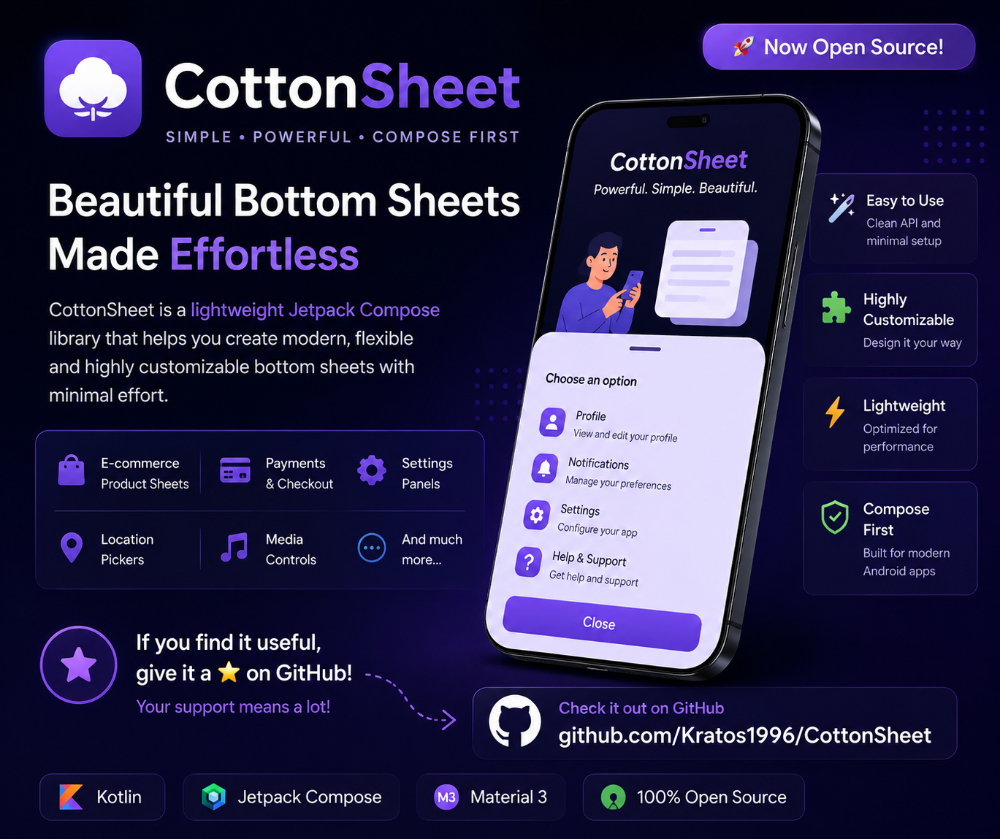

# CottonSheet 🌿

[](https://search.maven.org/artifact/io.github.kratos1996/cottonsheet)
[](http://kotlinlang.org)
[](https://github.com/JetBrains/compose-multiplatform)
[](LICENSE)

**CottonSheet** is a zero-boilerplate, fully parameterized, responsive, and **stackable** `ModalBottomSheet` library for **Compose Multiplatform**. It allows you to manage bottom sheets globally via a simple controller API, keeping your UI logic clean, decoupled, and consistent across Android, iOS, Desktop, and Web.

---

## 🚀 Key Features

- **Multiplatform**: Android, iOS (Dynamic Island & safe insets compliant), Desktop (JVM), and Web (Wasm/JS).
- **Global Hosting**: Define your `CottonSheetHost` once at the root; trigger sheets from anywhere in your composable hierarchy.
- **Stacked Sheets**: Open multiple sheets sequentially on top of each other with seamless animations and dismiss management.
- **Responsive Width & Alignment**: Centered on Desktop and Tablets, full-width or custom width on Mobile.
- **Custom Outer Padding**: Easily create floating-card bottom sheets using `sheetPadding`.
- **Drag Handle Flexibility**:
  - Inside or **Outside/Above** the sheet card (`isDragHandleOutside = true`).
  - Completely hide the drag handle knob (`showDragHandle = false`).
  - Custom drag handle composable (`customDragHandle`).
- **Zero Boilerplate**: No need to manually create `rememberModalBottomSheetState` or deal with boolean visibility flags.
- **Full Theming Control**: Shapes, container colors, content colors, elevations, scrims, and window insets.

---

## 🧠 Architecture Overview

CottonSheet is designed around three simple primitives:

1. **`CottonSheetController`**:
   The state container. Maintains a reactive stack of active sheet entries (`CottonSheetEntry`). Calling `show()` pushes a new sheet layer, while `dismiss()` or `dismissAll()` pops them with proper exit animations and callbacks.

2. **`CottonSheetHost`**:
   The root presentation container. Wrap your root UI with this once. It observes the controller stack and renders each sheet using isolated composition keys (`key(entry.id)`), guaranteeing independent animations and state.

3. **`CottonSheetParams`**:
   A declarative configuration data class covering dimensions, layout, drag handles, animations, shapes, and colors.

---

## 📦 Installation

Add the dependency to your `commonMain` source set in `build.gradle.kts`:

```kotlin
kotlin {
    sourceSets {
        commonMain.dependencies {
            implementation("io.github.kratos1996:cottonsheet:1.0.7")
        }
    }
}
```

---

## 🛠️ Setup

Wrap your application's root content with `CottonSheetHost`:

```kotlin
@Composable
fun App() {
    MaterialTheme {
        CottonSheetHost {
            // Your app content or Navigation Graph
            MainScreen()
        }
    }
}
```

---

## 💡 Usage Examples

Access the controller from any composable using `LocalCottonSheetController.current`.

### 1. Basic Sheet
```kotlin
val cottonSheet = LocalCottonSheetController.current

Button(onClick = {
    cottonSheet.show { dismiss ->
        Column(modifier = Modifier.padding(24.dp)) {
            Text("Hello from CottonSheet!")
            Button(onClick = dismiss) { Text("Close") }
        }
    }
}) {
    Text("Open Sheet")
}
```

### 2. Custom Width & Centered (Desktop / Tablet)
```kotlin
cottonSheet.show(
    params = CottonSheetParams(
        sheetWidth = 480.dp, // Centered on desktop, tablet, or phone
        isDismissable = true
    )
) { dismiss ->
    SheetContent(onClose = dismiss)
}
```

### 3. Floating Bottom Sheet (Outer Padding)
Add padding around the bottom sheet to achieve a floating card effect:

```kotlin
cottonSheet.show(
    params = CottonSheetParams(
        sheetWidth = 500.dp,
        sheetPadding = PaddingValues(start = 20.dp, end = 20.dp, bottom = 20.dp),
        shape = RoundedCornerShape(24.dp)
    )
) { dismiss ->
    SheetContent(onClose = dismiss)
}
```

### 4. Outside Drag Handle
Position the drag handle knob outside and above the bottom sheet card:

```kotlin
cottonSheet.show(
    params = CottonSheetParams(
        isDragHandleOutside = true,
        dragHandleOutsideSpacing = 8.dp, // Distance above the sheet
        shape = RoundedCornerShape(24.dp)
    )
) { dismiss ->
    SheetContent(onClose = dismiss)
}
```

### 5. Hide Drag Handle
```kotlin
cottonSheet.show(
    params = CottonSheetParams(
        showDragHandle = false,
        shape = RoundedCornerShape(topStart = 24.dp, topEnd = 24.dp)
    )
) { dismiss ->
    SheetContent(onClose = dismiss)
}
```

### 6. Full-Screen Sheet (Safe Insets)
Fills the screen height while automatically respecting the top status bar and Dynamic Island:

```kotlin
cottonSheet.show(
    params = CottonSheetParams(
        isFullScreen = true,
        isDismissable = true
    )
) { dismiss ->
    SheetContent(onClose = dismiss)
}
```

### 7. Stacked Sheets
Open another sheet directly from within an existing one. CottonSheet manages the overlay stack automatically:

```kotlin
cottonSheet.show { dismiss1 ->
    Column(Modifier.padding(24.dp)) {
        Text("Sheet 1")
        Button(onClick = {
            cottonSheet.show { dismiss2 ->
                Column(Modifier.padding(24.dp)) {
                    Text("Sheet 2 (Stacked above Sheet 1)")
                    Button(onClick = dismiss2) { Text("Close Sheet 2") }
                    Button(onClick = { cottonSheet.dismissAll() }) { Text("Close All") }
                }
            }
        }) {
            Text("Open Stacked Sheet")
        }
        Button(onClick = dismiss1) { Text("Close Sheet 1") }
    }
}
```

---

## ⚙️ API Reference

### `CottonSheetParams`

| Parameter | Type | Default | Description |
| :--- | :--- | :--- | :--- |
| `sheetWidth` | `Dp?` | `null` | Explicit width for the sheet (e.g. `480.dp`). When `null`, uses `sheetMaxWidth`. |
| `sheetMaxWidth` | `Dp` | `640.dp` | Maximum width constraint for large screens / desktop. |
| `sheetPadding` | `PaddingValues` | `PaddingValues(0.dp)` | Outer margin / padding around the bottom sheet (e.g. for floating cards). |
| `showDragHandle` | `Boolean` | `true` | Show or completely hide the drag handle knob. |
| `isDragHandleOutside` | `Boolean` | `false` | When true, renders the drag handle knob outside/above the bottom sheet card. |
| `dragHandleOutsideSpacing` | `Dp` | `8.dp` | Spacing between the outside drag handle knob and the top of the sheet surface. |
| `dragHandleColor` | `Color` | `Gray (0.4 alpha)` | Color of the default drag handle knob. |
| `dragHandleWidth` | `Dp` | `32.dp` | Width of the default drag handle knob. |
| `dragHandleHeight` | `Dp` | `4.dp` | Height of the default drag handle knob. |
| `customDragHandle` | `Composable?` | `null` | Custom composable to replace the default drag handle. |
| `shape` | `Shape?` | `null` | Corner shape (defaults to M3 `ExpandedShape`). |
| `containerColor` | `Color?` | `null` | Sheet background color. |
| `contentColor` | `Color?` | `null` | Foreground content color. Auto-derived when null. |
| `tonalElevation` | `Dp` | `1.dp` | Material tonal elevation overlay. |
| `scrimColor` | `Color?` | `null` | Dimmed background scrim color. |
| `skipPartiallyExpanded` | `Boolean` | `true` | When true, skips the intermediate half-expanded state. |
| `isFullScreen` | `Boolean` | `false` | When true, sheet expands to full height (status-bar safe). |
| `isDismissable` | `Boolean` | `true` | Whether tapping scrim or pressing back dismisses the sheet. |
| `dismissRequest` | `(() -> Unit)?` | `null` | Invoked when a dismiss is requested by the system or user. |
| `onDismissed` | `(() -> Unit)?` | `null` | Invoked after the sheet finishes its exit animation completely. |
| `windowInsets` | `WindowInsets?` | `null` | Custom window insets for sheet content. |

### `CottonSheetController`

| Method | Description |
| :--- | :--- |
| `show(params, content)` | Pushes a new sheet layer onto the stack. |
| `dismiss()` | Dismisses the top-most sheet with exit animation. |
| `dismissById(id)` | Dismisses a specific sheet entry by its unique identifier. |
| `dismissAll()` | Dismisses and clears all sheets in the stack. |

---

## 🌍 Platform Support

| Platform | Status |
| :--- | :---: |
| **Android** | ✅ |
| **iOS** | ✅ |
| **Desktop (JVM - macOS, Windows, Linux)** | ✅ |
| **Web (Wasm / JS)** | ✅ |

---

## 📄 License

```text
Copyright 2026 Ishant Sharma

Licensed under the Apache License, Version 2.0 (the "License");
you may not use this file except in compliance with the License.
You may obtain a copy of the License at

    http://www.apache.org/licenses/LICENSE-2.0
```
